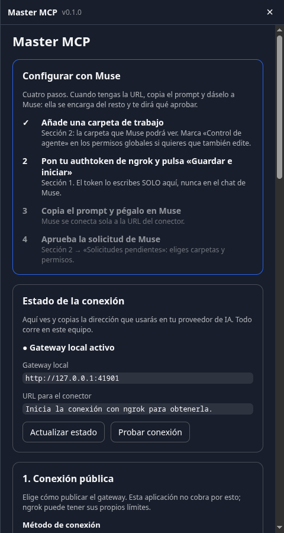

> **Código de referido de Muse: `S1JLLM`**

<div align="center">

# Muse MCP Desktop

**Muse y tu propio Master MCP en una sola app de escritorio para Linux y Windows.**

[](https://github.com/tuangel134/muse-mcp-desktop/actions/workflows/build.yml)
[](LICENSE)
-lightgrey)

[Descargar](https://github.com/tuangel134/muse-mcp-desktop/releases) ·
[Configuración paso a paso](#configuración-paso-a-paso) ·
[Seguridad](#seguridad) ·
[Solución de problemas](#solución-de-problemas) ·
[English](#english)



</div>

---

Instalas la app, pegas tu credencial de ngrok, copias un prompt y se lo das a **Muse**: Muse se conecta sola a tu equipo
y te guía con el resto. El **Master MCP** (archivos, búsqueda, git, terminal y navegador, siempre con permisos que tú
apruebas) corre dentro de la propia app: no hay que instalar servidores ni editar archivos de configuración.

> **Proyecto independiente y de código abierto. No está afiliado ni respaldado por Meta.** La app solo abre el sitio web
> público de Muse en su propia ventana y necesitas tu propia cuenta de Muse. «Muse» y su logotipo son marcas de Meta
> (ver [`THIRD_PARTY.md`](THIRD_PARTY.md)).

> ⚠️ **Windows: beta, sin probar.** Los instaladores de Windows se generan en GitHub Actions y su autor no ha podido
> probarlos en un equipo Windows real. En Windows no hay sandbox para la terminal: solo funciona con el permiso
> «Terminal del host». **Linux está probado.** Si encuentras fallos, abre un *issue*.

## Características

- **Todo en una ventana:** Muse a la izquierda, gestor de Master MCP a la derecha (`Ctrl+Mayús+M` lo muestra u oculta).
- **Asistente guiado de cuatro pasos** y un **prompt listo** para que Muse se configure sola.
- **Herramientas completas para Muse:** lectura y edición de archivos, búsqueda, git, pruebas, terminal con
  clasificación de riesgo y navegador controlado.
- **Tú decides todo:** cada conexión pide aprobación manual, por carpeta y por permiso, y se revoca cuando quieras.
- **Seguro por defecto:** los permisos de riesgo elevado (terminal del host, sudo, SSH, Docker, discos) vienen apagados.
- **Sin servidores extra:** el túnel público (ngrok) y el Master MCP van incluidos en la app.

## Instalación

Descarga el instalador de tu sistema desde la página de [**Releases**](https://github.com/tuangel134/muse-mcp-desktop/releases).

### Linux

| Formato | Cómo |
|---|---|
| **AppImage** | `chmod +x Muse-MCP-Desktop-*-linux.AppImage && ./Muse-MCP-Desktop-*-linux.AppImage` |
| **.deb** (Debian, Ubuntu…) | `sudo apt install ./Muse-MCP-Desktop-*-linux.deb` |
| **Desde el código** (Arch y otras con Electron instalado) | `git clone https://github.com/tuangel134/muse-mcp-desktop && cd muse-mcp-desktop && npm install --ignore-scripts && bash scripts/install-linux.sh` |

La última opción instala la app para tu usuario, sin `sudo`, con entrada en el menú de aplicaciones. Para quitarla:
`bash scripts/install-linux.sh --uninstall`.

Recomendado: instala `bubblewrap` (`bwrap`) para que la terminal de las herramientas corra aislada.

### Windows (beta)

Descarga el instalador `.exe` (o el `.zip` portátil) y ejecútalo. Windows puede avisar de que el editor es
desconocido: la app no está firmada digitalmente.

## Configuración paso a paso

Al abrir la app verás Muse a la izquierda y el panel **Master MCP** a la derecha. Si no ves el panel, pulsa
`Ctrl+Mayús+M`. Inicia sesión en Muse como siempre y sigue estos pasos en el panel, en el apartado
**«Configurar con Muse»**:

### 1. Añade una carpeta de trabajo

En la sección **2. Proyectos y permisos**, pulsa **Seleccionar carpeta…** y luego **Añadir**. Es la única carpeta que
Muse podrá ver; empieza por una de prueba.

Si quieres que Muse también **edite** archivos, abre **Permisos globales disponibles**, marca **Control de agente** y
pulsa **Guardar permisos globales**.

### 2. Crea tu túnel con ngrok

Muse necesita llegar a tu equipo por una dirección HTTPS pública, y de eso se encarga [ngrok](https://ngrok.com).

1. Crea una cuenta gratuita en <https://ngrok.com> y entra en el panel.
2. Copia tu **Authtoken** (apartado *Your Authtoken* o *Getting Started*).
3. En la sección **1. Conexión pública** del panel elige **Automático con ngrok**, pega el token y pulsa
   **Guardar e iniciar**.

Si tu cuenta tiene un dominio estático gratuito (`algo.ngrok-free.dev`), puedes escribirlo en **Dominio reservado**;
es opcional. El token se guarda **cifrado** en tu equipo y nunca se vuelve a mostrar.

Al terminar aparece la **URL del conector**, con el formato `https://…/mcp`.

> 🔒 **El token de ngrok se escribe solo en el panel de la app, nunca en el chat de Muse.**

### 3. Dale el prompt a Muse

Cuando exista la URL del conector, pulsa **Pegar el prompt en Muse** (lo escribe en la caja de texto de Muse; revísalo
y envíalo) o **Copiar prompt para Muse** y pégalo tú. El prompt le explica a Muse qué servidor MCP usar, cómo
autenticarse y cómo comprobar que funciona, y le prohíbe pedirte credenciales.

El texto está en [`prompts/setup-prompt.md`](prompts/setup-prompt.md) por si quieres ajustarlo.

### 4. Aprueba la conexión

Muse se conectará y, si hace falta, se abrirá una **ventana de autorización dentro de la app** (en la página de ngrok
puede aparecer un aviso: pulsa **Visit Site**). Después, la solicitud queda en **Solicitudes pendientes** del panel:

1. Marca las **carpetas** que podrá ver.
2. Revisa los **permisos** (`Solo lectura` o los que quieras conceder).
3. Pulsa **Aceptar conexión y dar acceso**.

Nada se aprueba solo. Cuando el panel muestre un acceso activo, pídele a Muse algo sencillo, como *«lista los archivos de
mi carpeta de trabajo»*. Puedes cambiar permisos o **revocar** el acceso en cualquier momento desde **Accesos activos**.

## Permisos

Todos están en **Permisos globales disponibles**. Los marcados con ⚠ vienen apagados y piden una segunda confirmación.

| Permiso | Qué permite |
|---|---|
| Lectura | Listar y leer archivos de las carpetas aprobadas (siempre incluido). |
| Control de agente | Crear, editar y borrar archivos, ejecutar comandos y pruebas dentro de la carpeta. |
| Controlar navegador | Abrir y leer páginas en un navegador Chromium aparte, con su propio perfil. |
| Archivos fuera del proyecto | Leer y editar rutas externas a la carpeta de trabajo. |
| Red en terminal | Que los comandos descarguen o se conecten a internet. |
| Archivos protegidos | Leer `.env` y credenciales del proyecto. |
| Terminal del host ⚠ | Comandos fuera del sandbox, con tus permisos de usuario. En Windows es la única terminal. |
| Dispositivos USB / ADB ⚠ | Controlar dispositivos Android por ADB. |
| Sistema y discos ⚠ | Modificar `/usr`, `/etc`, `/var` y usar `dd`, `mkfs`, `fdisk`. |
| Claves SSH ⚠ | Usar `~/.ssh` desde los comandos. |
| Docker del host ⚠ | Usar Docker y su socket. |
| Unidades montadas ⚠ | Acceder a `/mnt` y `/media`. |
| Solicitar sudo ⚠ | Usar `sudo` y gestionar paquetes del sistema. Linux seguirá pidiendo la contraseña. |

## Seguridad

- **Solo local.** El Master MCP escucha únicamente en `127.0.0.1`. La API de gestión usa un token aleatorio que solo
  conoce el proceso principal de la app; la página del panel y Muse nunca lo ven, y se rechaza cualquier petición con
  cabecera `Origin`.
- **Solo es público el endpoint MCP**, protegido con **OAuth 2.1** (registro dinámico de clientes + PKCE). Cada
  conexión pide aprobación manual, por carpeta y por permiso, y se puede revocar.
- **Los comandos se clasifican antes de ejecutarse.** Se permiten lecturas, ediciones y borrados normales dentro de las
  carpetas de trabajo. Se rechazan `chmod`/`chown` amplios, `curl | sh`, `git push`, y borrar `/`, tu carpeta personal,
  `~/.ssh`, `~/.config` o el sistema. `sudo` y los gestores de paquetes se desbloquean con **Solicitar sudo**, y
  `dd`/`mkfs`/`fdisk` con **Sistema y discos**; ambos permisos requieren además **Terminal del host**.
- **Sandbox en Linux** con `bubblewrap` para la terminal del proyecto.
- **Datos locales:** el token de ngrok y las autorizaciones se guardan cifrados en tu equipo.

Una IA conectada puede actuar con tus permisos dentro de lo que apruebes: **concede lo mínimo que necesites**. El
software se ofrece **sin garantía** (ver [`LICENSE`](LICENSE)). Para reportar una vulnerabilidad, abre un *issue*
sin incluir datos sensibles.

## Solución de problemas

**Muse no me deja iniciar sesión en la app.** Algunos servicios bloquean navegadores embebidos. Prueba a recargar
(`Ctrl+R`); si persiste, abre un *issue* indicando el mensaje que muestra Muse.

**Muse dice que se conecte pero no aparece la ventana de autorización.** Actualiza a la última versión: las ventanas
emergentes se abren dentro de la app. Si ya la tienes, reinicia la app y pídele a Muse que vuelva a conectar.

**ngrok dice que el dominio o el túnel ya está en uso.** Solo puede haber un túnel con el mismo dominio a la vez.
Detén cualquier otro programa que use tu cuenta o ese dominio, o quita el dominio reservado en la sección 1.

**La terminal de las herramientas falla en Linux.** Instala `bubblewrap` (`bwrap`). Si usas un permiso de «Terminal del
host», no hace falta.

**En Windows la terminal dice que no está disponible.** En Windows no hay sandbox: activa **Terminal del host** en los
permisos globales y vuelve a aprobar la conexión.

**Muse no encuentra mi carpeta o dice que no tiene permiso.** Comprueba que la carpeta esté añadida, que la conexión la
incluya en **Accesos activos** y que el permiso necesario (por ejemplo **Control de agente** para editar) esté marcado.

**Dónde están los registros y los datos.**
- Linux: `~/.config/muse-mcp-desktop/` (registro del Master MCP en `host.log`)
- Windows: `%APPDATA%\muse-mcp-desktop\`

Desde la app, el menú oculto sigue accesible con los atajos: `Ctrl+Mayús+M` (panel), `Ctrl+R` (recargar Muse),
`Ctrl+Q` (salir) y `Ctrl +`/`Ctrl -`/`Ctrl 0` (zoom).

## Desarrollo

```bash
npm install                 # instala dependencias (descarga Electron)
npm start                   # compila host/host.cjs y abre la app
npm test                    # pruebas del clasificador de comandos y del host
node host/tests/e2e.mjs     # E2E de OAuth + MCP con estado temporal (no toca nada real)
npm run dist                # empaqueta para tu sistema con electron-builder
```

- `electron/` — proceso principal: ventana, panel, proceso hijo del Master MCP, IPC.
- `panel/` — interfaz del gestor de Master MCP.
- `host/src/` — Master MCP en TypeScript; `npm run build:host` lo empaqueta en `host/host.cjs` con esbuild.
- `prompts/setup-prompt.md` — el prompt de configuración que recibe Muse.
- `scripts/install-linux.sh` — instalador de usuario para Linux.
- Variables útiles: `MUSE_URL` (otra URL en vez de muse.ai), `MUSE_MCP_DISPLAY` (abrir en el monitor cuyo nombre
  contenga el texto), `MUSE_MCP_BROWSER` (navegador Chromium para las herramientas de navegador), `MUSE_MCP_ICON`
  (icono de la ventana).

Las contribuciones son bienvenidas: abre un *issue* o un *pull request*. Las pruebas deben pasar (`npm test` y el E2E).

## Licencia y créditos

[MIT](LICENSE). El núcleo del Master MCP deriva de *Tessarion MasterMCP Lite* (MIT, ver
[`THIRD_PARTY.md`](THIRD_PARTY.md) y `LICENSE-TESSARION-MasterMCP-Lite`). Construido con Electron, esbuild y
`@ngrok/ngrok`.

---

## English

**Muse MCP Desktop** is an Electron app that shows Meta's Muse web app next to a built-in **Master MCP** manager
(folders, permissions, ngrok tunnel, OAuth approvals). Unofficial and not affiliated with Meta. Linux is tested;
**Windows builds come from GitHub Actions and are beta/untested**.

**Quick start**

1. Download the installer from [Releases](https://github.com/tuangel134/muse-mcp-desktop/releases): AppImage or `.deb`
   for Linux, `.exe` or `.zip` for Windows. On Arch-like systems with Electron installed you can also run
   `bash scripts/install-linux.sh` from a clone.
2. Open the app and sign in to Muse. Use the right-hand panel (`Ctrl+Shift+M`) and follow **«Configurar con Muse»**:
   1. Add a **workspace folder** (and tick *Control de agente* in the global permissions if Muse should edit files).
   2. Create a free [ngrok](https://ngrok.com) account, copy your **authtoken**, choose *Automático con ngrok*, paste
      it and press **Guardar e iniciar**. Never paste the token into Muse's chat.
   3. Press **Pegar el prompt en Muse** (or **Copiar prompt para Muse**) and send it to Muse. It will connect to the
      MCP URL and verify it works.
   4. **Approve** the pending request in the panel: choose folders and permissions.
3. Ask Muse something simple, like *"list the files in my workspace"*. Revoke access any time under *Accesos activos*.

**Security in short:** the control API listens on `127.0.0.1` only and rejects any request with an `Origin` header; the
public endpoint is OAuth 2.1 (dynamic client registration + PKCE) with manual approval per folder and permission;
high-risk permissions (host terminal, sudo, SSH, Docker, disks) are off by default; commands are risk-classified before
they run; Linux uses `bubblewrap` for the terminal sandbox. The software is provided **without warranty**.

MIT licensed. The MCP core derives from Tessarion MasterMCP Lite (MIT).
